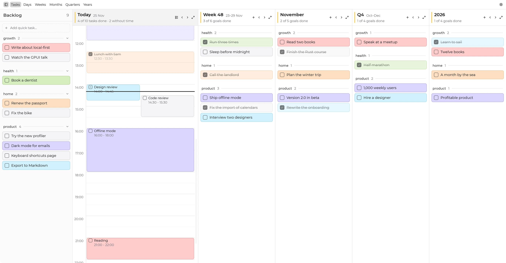
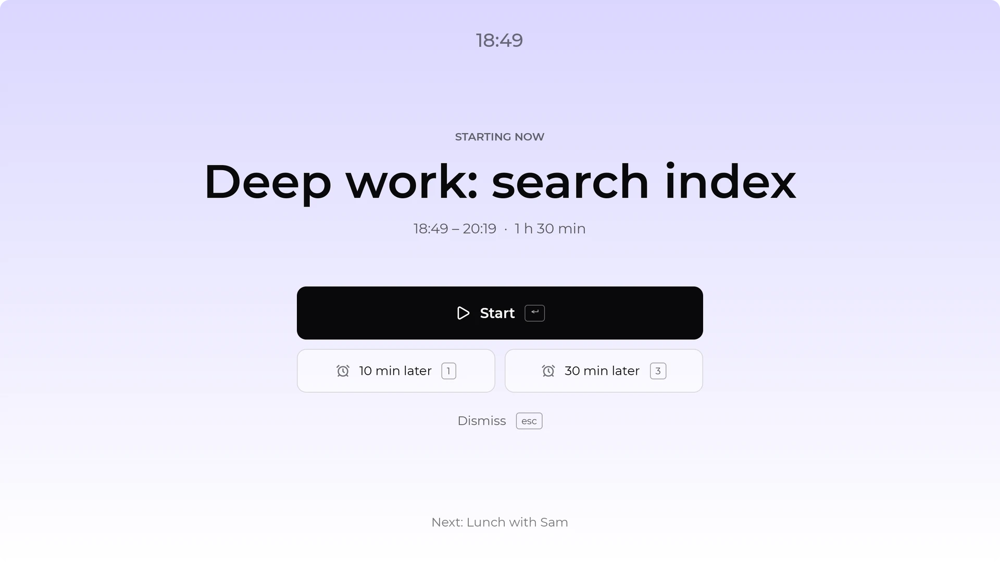
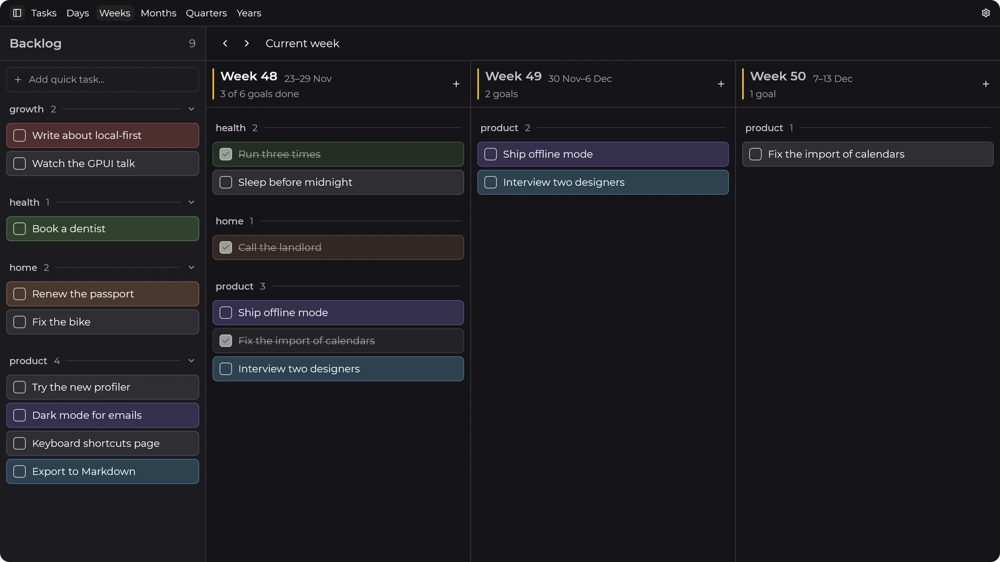
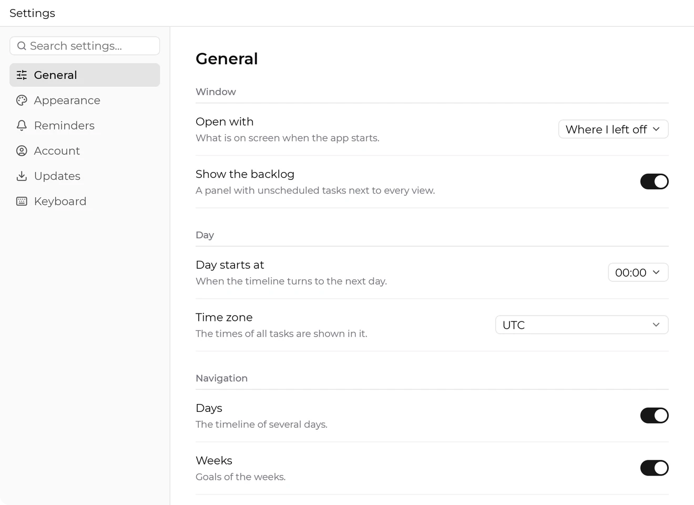

<h1 align="center">Tasks for the desktop</h1>

<p align="center">
  Your day, your goals and your backlog in one native window.<br>
  Built on <a href="https://www.gpui.rs">GPUI</a>, for Linux and macOS.
</p>

<p align="center">
  
</p>

## Install

```sh
curl -fsSL https://github.com/nanolookc/tasks-desktop/releases/latest/download/install.sh | sh
```

Linux (x86_64, glibc 2.35 or newer) and macOS (Apple Silicon). The same command
repairs an installation. The app then updates itself: a new version is installed
in the background and runs from the next start on.

## What is in it

- **Everything on one screen.** Today's timeline next to the goals of the week,
  month, quarter and year, and a view for each of them.
- **A backlog at hand.** Note things down in the side panel, then drag them to a
  time or to a goal, and back.
- **A timeline that follows the pointer.** Click or draw to create, drag to
  move and resize; the preview shows where the task will land.
- **Reminders that cannot be missed.** Full screen before a task, at its start
  and at its end. Start, finish, or push it back: what follows makes room.
- **Always in step.** Changes made on the web and on the phone show up as they
  happen.

<table>
  <tr>
    <td width="50%"></td>
    <td width="50%"></td>
  </tr>
  <tr>
    <td align="center">Full-screen reminders</td>
    <td align="center">A view for every horizon, light and dark</td>
  </tr>
</table>

<p align="center">
  
</p>

## Keyboard

| Key | Action |
| --- | --- |
| <kbd>Ctrl</kbd> <kbd>B</kbd> | Show or hide the backlog |
| <kbd>Ctrl</kbd> <kbd>,</kbd> | Settings |
| <kbd>←</kbd> <kbd>→</kbd> | Earlier and later days or periods |
| <kbd>T</kbd> | Today |
| <kbd>N</kbd> | New task now |
| <kbd>Enter</kbd> | Open the selected task |
| <kbd>Space</kbd> | Done / to do |
| <kbd>Delete</kbd> | Delete, after a confirmation |
| <kbd>Ctrl</kbd> <kbd>Enter</kbd> | Save the form |
| <kbd>Esc</kbd> | Cancel a drag, close the form, clear the selection |
| <kbd>Ctrl</kbd> <kbd>R</kbd>, <kbd>F5</kbd> | Reload |
| <kbd>Ctrl</kbd> <kbd>W</kbd>, <kbd>Ctrl</kbd> <kbd>Q</kbd> | Close |

In a reminder: <kbd>Enter</kbd> starts or finishes the task, <kbd>1</kbd> and
<kbd>3</kbd> give it 10 or 30 minutes, <kbd>Esc</kbd> dismisses it. On macOS
<kbd>Ctrl</kbd> is <kbd>Cmd</kbd>.
